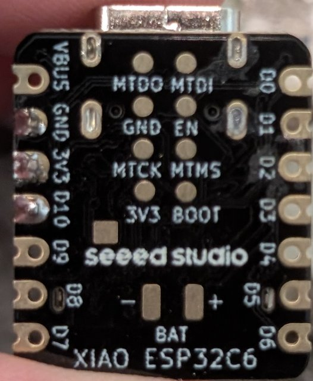
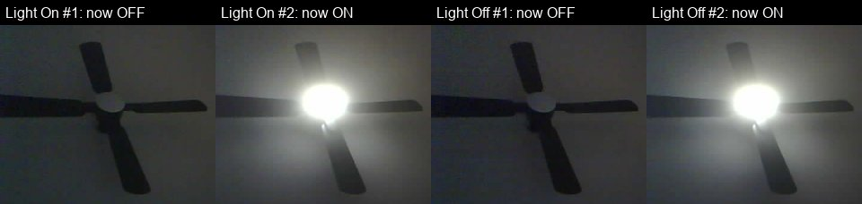

# fan-esphome

ESPHome firmware that turns a Seeed XIAO ESP32-C6 and a cheap 433 MHz transmitter into a WiFi bridge for RF-remote ceiling fans. Home Assistant controls the fans and lights over the ESPHome native API. Because RF is one-way, the bridge can send commands, but it can't read back a fan's current state.

## Supported fans

| Fan | Remote | Home Assistant gets | Status |
|---|---|---|---|
| [Mainstays 42 in. Hugger Ceiling Fan with LED Light](https://www.walmart.com/ip/Mainstays-42-in-Hugger-Ceiling-Fan-with-LED-Light-Remote-Control-6-Speeds-Reverse-Airflow-Black-Walnut-Blades/19292811884), model FSI 90-4201H-4B | 433.92 MHz OOK, 32-bit frames, 16-bit address per remote | Fan entity (speeds 1–6, off, direction) plus 13 buttons: Light On/Off, raw speeds, off, reverse, color, brighter, dimmer | Two fans configured. RF replay checked by SDR on one fan. See [verification](#how-these-fans-were-recorded-and-verified). |
| [Artika Sunnyvale 28" Fandelier with Remote](https://www.costco.com/p/-/artika-sunnyvale-28-fandelier-with-remote/4000392789) | REM-ARTC-3, FCC ID 2AUHG-FAN-SUR2, 433.92 MHz, 24-bit fixed codes | 13 buttons: Light On/Off, Fan Power Toggle, Speed 1–3, Reverse, Brightness Up/Down, Cooler, Warmer, Timer 1h/4h | I tested all 13 after moving the bridge closer to the fan |

A few things to keep in mind:

- **Light On and Light Off both send the remote's light toggle.** Neither remote has separate on and off commands, so either button can switch the light either way, and every press goes out even if you hit the same button twice.
- **The fan state in Home Assistant is assumed.** Using the physical remote or any of the raw buttons won't update it.
- **Your remote has its own address.** The codes in this repo belong to my remotes, so you'll need an SDR once to read your remote's address before your fan will respond (see [Adding a fan](#adding-a-fan-or-a-new-remote)). Once a controller is configured, you don't need an SDR to run it.
- **Not measured:** I didn't time out the full 1h/4h timer durations, measure the RF carrier frequency, or test the usable range.

## Hardware

### Required to run the controller

| Part | Notes |
|---|---|
| Seeed Studio XIAO ESP32-C6 | Transmit data on **D10 = GPIO18** |
| FS1000A 433 MHz OOK transmitter (board marked XLC-FST) | Wired DATA → D10, VCC → 3V3, GND → GND (see photos). Powered from **3.3 V** here; VBUS/5 V is unused. |
| 2.4 GHz U.FL WiFi antenna for the XIAO | **Required as configured.** My board's built-in ceramic antenna found no networks, so the firmware drives GPIO3 LOW and GPIO14 HIGH to select the U.FL connector. If your board's ceramic antenna works, set `antenna_select` in `fan-esphome.yaml` to `ALWAYS_OFF`. |
| 433 MHz antenna on the transmitter (recommended) | I added a ~6.8 in (17 cm) antenna and saw better signal strength and range, though that's just an observation rather than a measured gain or a tuned length. Separate from the WiFi antenna. |
| USB-C power supply and data cable | Needed for the first flash; later updates go over WiFi |

Placement matters. My first Artika light test failed and only worked once I moved the bridge closer to the fan. FS1000A listings commonly quote 3.5–12 V and longer range at higher voltage, but I've only run this build at 3.3 V; 5 V is untested here.

There's also an optional snap-fit enclosure for this board pair, though it's not part of this repo.

### Optional: capture and verification gear

| Item | Needed for |
|---|---|
| RTL-SDR dongle (I used an RTL2832U + R820T2, such as a Nooelec NESDR Mini 2) and the native `rtl_sdr` program | **Required once** to read a new remote's address or decode a new protocol, and handy for checking the bridge's transmissions. |
| PC microphone | Lets `tools/rf_bench.py` hear the fan's beep. See [Automating fan discovery](#automating-fan-discovery-for-a-coding-agent). |
| Camera aimed at the fan (any URL that returns a JPEG snapshot; I used an ESP32 camera board running ESPHome) | Lets `tools/rf_bench.py` see the light and blades change. Optional even for the bench. |
| FFmpeg | `rf_bench.py --video` only |

### Build photos and wiring

The transmitter's three header pins solder straight into the XIAO's GND, 3V3, and D10 pads, with no separate wires. I took these photos before adding the 433 MHz antenna.

| XIAO back: GND, 3V3, D10 soldered; VBUS bare | FS1000A: DATA, VCC, GND header; ANT pad | Assembled, transmitter upright beside the USB-C port |
|---|---|---|
|  |  |  |


## Quick start

I tested this on Windows with Python 3.11 and ESPHome 2026.6.5. Run these commands from PowerShell, since ESP-IDF builds fail under Git Bash. On Linux or macOS, use `python3` and `.venv/bin/` instead of `.venv\Scripts\`.

1. Set up the Python environment (this is the only dependency needed to build and run the controller):

   ```powershell
   python -m venv .venv
   .venv\Scripts\python -m pip install -r requirements.txt
   ```

2. Create your local config files and generate an API key. Both files are git-ignored so your credentials and room names stay off GitHub:

   ```powershell
   copy secrets.example.yaml secrets.yaml        # WiFi, fallback AP, OTA password, API key
   copy fan-names.example.yaml fan-names.yaml    # display names, e.g. room names
   .venv\Scripts\python -c "import base64,secrets;print(base64.b64encode(secrets.token_bytes(32)).decode())"
   ```

   Paste the generated key into `secrets.yaml` as `api_encryption_key`, since ESPHome rejects the placeholder value.

3. Set up your fans. Put your remote's address in the `packages:` list of `fan-esphome.yaml` and its codes in `artika.yaml` (see [Adding a fan](#adding-a-fan-or-a-new-remote)), then remove the packages for any fans you don't have.

4. Validate, build, and flash. The first compile downloads the ESP-IDF toolchain and takes several minutes:

   ```powershell
   .venv\Scripts\esphome config fan-esphome.yaml
   .venv\Scripts\esphome run fan-esphome.yaml --device COM5   # first flash over USB; use your port
   .venv\Scripts\esphome run fan-esphome.yaml                 # later updates over WiFi
   .venv\Scripts\esphome logs fan-esphome.yaml                # each press logs "RF TX ..."
   ```

5. Add the bridge in Home Assistant under Settings → Devices & services. Home Assistant usually discovers `fan-esphome` automatically; enter the API key from `secrets.yaml` when prompted. Keep the U.FL WiFi antenna connected and the power stable. Once it's set up in Home Assistant, you don't need the PC or SDR anymore.

### Using it in Home Assistant

- In automations, call `button.press` on the Light On and Light Off buttons, since they aren't `light.turn_on` entities.
- Mainstays fan entities only send what changed: a speed, off, or one reverse toggle per direction change. Reverse only takes effect while the fan is stopped.
- Artika speed buttons and Fan Power Toggle are separate buttons, with no fan entity, because the remote only has a power toggle.
- Renaming a fan in `fan-names.yaml` changes its Home Assistant entity identity and requires a rebuild and flash. If you just want to rename a room, set a friendly name in Home Assistant instead (see [migration notes](docs/PROTOCOLS.md#home-assistant-migration-notes)).

## Adding a fan or a new remote

All you need here is the SDR; the microphone and camera are just optional extras.

- **Another fan of a supported family:** follow [`.agents/skills/adding-fans`](.agents/skills/adding-fans/SKILL.md) to capture any button with `tools/rf_capture.py`, then add one package line and a local name.
- **A remote of a different brand:** follow [`.agents/skills/investigating-fan-remotes`](.agents/skills/investigating-fan-remotes/SKILL.md), which walks through the FCC ID lookup, capturing every button, decoding, and a supervised replay.

Both guides are written as agent skills, but people can follow them just as easily. They only need files in this repo and the SDR setup below.

### Optional tool setup

```powershell
.venv\Scripts\python -m pip install -r tools\requirements.txt
.venv\Scripts\python tools\rf_capture.py record my_remote --seconds 6   # SDR only
.venv\Scripts\python tools\rf_bench.py --button "Fan 3 RF Speed 1" --expect <32 bits> --mic "PART_OF_MIC_NAME"
```

| Tool | Needs |
|---|---|
| `tools/rf_capture.py`: record and decode any PWM OOK remote to raw `.cu8` | RTL-SDR, `rtl_sdr`, numpy (matplotlib for `--plot`) |
| `tools/rf_bench.py`: press through the API, record SDR + mic + camera on one clock, decode the Mainstays 32-bit frames | All of `tools/requirements.txt`, `rtl_sdr`, a microphone, and the camera optionally |
| `tools/make_readme_figures.py`: regenerate the figures below | Local recordings (not in the repo) |

For `rtl_sdr`, either put it on `PATH` or point the `RTL_SDR_EXE` environment variable to its full path:

- **Windows:** download the osmocom rtl-sdr Windows release and install the WinUSB driver for the dongle with Zadig. I used a local `rtl_sdr.exe` selected via `RTL_SDR_EXE`.
- **Debian/Ubuntu:** `sudo apt install rtl-sdr libportaudio2`. If the kernel DVB driver claims the dongle, blacklist `dvb_usb_rtl28xxu`.
- **macOS:** `brew install librtlsdr portaudio`.

I've only used the Windows setup for this project, so the Linux and macOS steps are untested (`sounddevice` needs PortAudio on Linux and macOS). Close SDR# or anything else using the dongle first, and give `rtl_sdr` about 2 s before samples start flowing.

## Repository layout

| File | Contents |
|---|---|
| `fan-esphome.yaml` | Device, WiFi, antenna switch, transmitter, Mainstays timing and button bytes, list of fans |
| `fan.yaml` | One Mainstays fan, included once per fan with its address |
| `artika.yaml` | Artika 24-bit codes and waveform |
| `secrets.example.yaml`, `fan-names.example.yaml` | Neutral templates for the ignored local files |
| `requirements.txt` / `tools/requirements.txt` | Minimum build dependency / optional bench dependencies |
| `docs/PROTOCOLS.md` | Protocol detail, test history, verification limits, migration notes |
| `.agents/skills/` | Step-by-step guides for adding fans and investigating remotes |

Keep this repo private. `secrets.yaml`, `fan-names.yaml`, `.esphome/`, `.venv/`, and `runs/` (raw recordings, audio, and room camera frames) are git-ignored, and the committed images are cropped to just the boards or the fan. The configured RF addresses are committed on purpose, so review them before making anything public.

## Automating fan discovery for a coding agent

A coding agent wrote most of this firmware, which hit an obvious snag: it couldn't see the fans. Whenever it sent a command, the SDR showed the right frames going out, but that only proved the transmitter sent a code, not that the fan accepted it. After every press, the agent had to stop and ask me if anything actually happened, making me the slowest part of the loop.

So I hooked up ears and eyes for it:

- **Ears:** my PC microphone. The Mainstays fan beeps when it accepts a fan command, so a beep right after a press tells the agent the receiver heard it.
- **Eyes:** a small ESP32 camera board running ESPHome, pointed at the ceiling and serving a JPEG snapshot. Comparing pictures from before and after a press shows whether the light toggled and whether the blades started or stopped.

`tools/rf_bench.py` ties everything together on one clock: it starts the SDR, microphone, and camera, presses a button through the ESPHome API, and writes a short summary covering whether the right code went out, whether the fan beeped, and whether the light or blades changed. The agent reads that summary and decides what to try next without waiting on me.

With that loop in place, the agent could work through tests on its own:

- replay all 12 buttons on one fan and check each one;
- sweep button bytes `00`–`7F` hunting for separate light on and off commands (only the known toggle changed the light, and I stopped the sweep once the beeping and flashing got old);
- prove that Light On and Light Off are both toggles.

It still has its limits. A beep tells you a command arrived, not which speed it set, the camera can't tell blade direction or light color, and the three streams only line up approximately. Final sign-off still came from me watching the fan, and I tested the Artika fan by hand without the bench. You don't need a microphone or camera to use the bridge, and only the SDR if you're adding a fan.

**One bench run: the bridge sends Fan Off.** In the top panel, the SDR catches all 10 frames going out; in the middle panel, the fan beeps about 0.2 s later; and in the bottom panel, the camera watches the blades slow to a stop over about 40 s. The audio itself isn't published.


**The light buttons, seen by the camera.** Four presses in a row (On, On, Off, Off), cropped to the fan. The light flips every time, showing both buttons send the same toggle.



## How these fans were recorded and verified

I keep four kinds of evidence separate here, because each one proves something different:

- **Capture:** the original remote recorded on the RTL-SDR at 433.92 MHz and 1 MS/s.
- **Prediction:** a code computed from the protocol model, not actually captured.
- **RF replay:** the bridge's own transmission recorded on the same SDR. This proves what was sent, not that the fan accepted it.
- **Human confirmation:** I watched the fan respond.

The microphone and camera from above count as indirect evidence, not human confirmation.

**Capture: Mainstays remote, Speed 1.** This is one of ten repeated frames using 274/768 µs pulse-width coding. The 16-bit address identifies the remote, and the final nibble makes all eight nibbles XOR to zero, so the firmware can compute the code for any button. Codes for buttons that were never captured are predictions.


**Capture vs RF replay: Artika light toggle.** The top trace is the original remote and the bottom is the bridge's replay on the same SDR; both decode to `0x562305`, with timing within about 15 µs. That first replay didn't switch the light. After I moved the bridge closer, I confirmed every Artika control in Home Assistant (human confirmation, though I didn't record detailed observations for each button).


I generated the figures with `tools/make_readme_figures.py` from git-ignored recordings, and the build photos are cropped from my own photos with location metadata removed. For the full protocol tables, the discrete-light-command search, the Artika carrier analysis, and all the limits, see [docs/PROTOCOLS.md](docs/PROTOCOLS.md).
