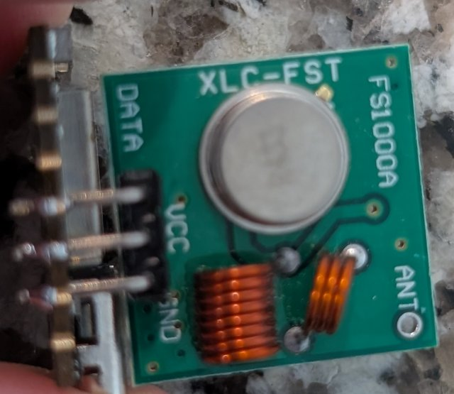

# fan-esphome

`fan-esphome` is ESPHome firmware for a Seeed Studio XIAO ESP32-C6 and a 433 MHz transmitter that bridges RF-remote ceiling fans to WiFi. Home Assistant controls the fans and lights over the ESPHome native API. The RF link is one-way: the bridge sends commands and can't read back a fan's current state.

## Supported fans

| Fan | Remote | Home Assistant gets | Status |
|---|---|---|---|
| [Mainstays 42 in. Hugger Ceiling Fan with LED Light](https://www.walmart.com/ip/Mainstays-42-in-Hugger-Ceiling-Fan-with-LED-Light-Remote-Control-6-Speeds-Reverse-Airflow-Black-Walnut-Blades/19292811884), model FSI 90-4201H-4B | 433.92 MHz OOK, 32-bit frames, 16-bit address per remote | Fan entity (speeds 1–6, off, direction) plus 13 buttons: Light On/Off, raw speeds, off, reverse, color, brighter, dimmer | Two fans configured. RF replay checked by SDR on one fan. See [docs/PROTOCOLS.md](docs/PROTOCOLS.md). |
| [Artika Sunnyvale 28" Fandelier with Remote](https://www.costco.com/p/-/artika-sunnyvale-28-fandelier-with-remote/4000392789) | REM-ARTC-3, FCC ID 2AUHG-FAN-SUR2, 433.92 MHz, 24-bit fixed codes | 13 buttons: Light On/Off, Fan Power Toggle, Speed 1–3, Reverse, Brightness Up/Down, Cooler, Warmer, Timer 1h/4h | I tested all 13 after moving the bridge closer to the fan |

Behavior and limits:

- **Light toggle:** Light On and Light Off both send the remote's light toggle. Neither remote has separate on and off commands, so either button switches the light in either direction. Every press transmits even if you press the same button twice.
- **Assumed fan state:** Home Assistant shows an assumed fan state. Using the physical remote or any raw button won't update it.
- **Per-remote address:** Each remote has its own address. The codes in this repository belong to my remotes, so you need an SDR once to read your remote's address before your fan responds (see [Adding a fan](#adding-a-fan-or-a-new-remote)). Running an already-configured controller doesn't need an SDR.
- **Not measured:** I didn't time out the full 1h/4h timer durations, measure the RF carrier frequency, or test the usable range.

## Hardware

### Required to run the controller

| Part | Notes |
|---|---|
| Seeed Studio XIAO ESP32-C6 | Transmit data on D10 = GPIO18 |
| FS1000A 433 MHz OOK transmitter (board marked XLC-FST) | Wired DATA → D10, VCC → 3V3, GND → GND (see photos). Powered from 3.3 V; VBUS/5 V is unused. |
| 2.4 GHz U.FL WiFi antenna for the XIAO | Required as configured. My board's built-in ceramic antenna found no networks, so the firmware drives GPIO3 LOW and GPIO14 HIGH to select the U.FL connector. If your board's ceramic antenna works, set `antenna_select` in `fan-esphome.yaml` to `ALWAYS_OFF`. |
| 433 MHz antenna on the transmitter (recommended) | I added a ~6.8 in (17 cm) antenna and saw better signal strength and range. That's an observation only; I didn't measure gain or tune the length. Separate from the WiFi antenna. |
| USB-C power supply and data cable | Needed for the first flash; later updates go over WiFi |

Transmitter placement affects reception: my first Artika light test failed until I moved the bridge closer to the fan. FS1000A listings commonly quote 3.5–12 V with longer range at higher voltage. This build runs at 3.3 V; 5 V transmitter power is untested. An optional snap-fit enclosure exists for this board pair outside this repository.

### Optional: capture and verification gear

| Item | Needed for |
|---|---|
| RTL-SDR dongle (I used an RTL2832U + R820T2, such as a Nooelec NESDR Mini 2) and the native `rtl_sdr` program | Required once to read a new remote's address or decode a new protocol; also checks the bridge's transmissions. |
| PC microphone | Records the fan's beep for `tools/rf_bench.py`. See [agent test feedback](#optional-give-a-coding-agent-test-feedback). |
| Camera aimed at the fan (any URL that returns a JPEG snapshot; I used an ESP32 camera board running ESPHome) | Captures JPEG snapshots for `tools/rf_bench.py` to detect light and blade changes. Optional even for the bench. |
| FFmpeg | `rf_bench.py --video` only |

### Build photos and wiring

The transmitter's three header pins solder straight into the XIAO's GND, 3V3, and D10 pads with no separate wires. I took the build photos before adding the 433 MHz antenna.

| XIAO back: GND, 3V3, D10 soldered; VBUS bare | FS1000A: DATA, VCC, GND header; ANT pad | Assembled, transmitter upright beside the USB-C port |
|---|---|---|
|  |  |  |


## Quick start

I tested this build on Windows with Python 3.11 and ESPHome 2026.6.5. Run the build commands from PowerShell, because ESP-IDF builds fail under Git Bash. On Linux or macOS, use `python3` and `.venv/bin/` instead of `.venv\Scripts\`.

1. Set up the Python virtual environment and install `requirements.txt` (the only dependency needed to build and run the controller):

   ```powershell
   python -m venv .venv
   .venv\Scripts\python -m pip install -r requirements.txt
   ```

2. Copy the local config templates and generate an API key. Git ignores both files so your credentials and room names stay off GitHub:

   ```powershell
   copy secrets.example.yaml secrets.yaml        # WiFi, fallback AP, OTA password, API key
   copy fan-names.example.yaml fan-names.yaml    # display names, e.g. room names
   .venv\Scripts\python -c "import base64,secrets;print(base64.b64encode(secrets.token_bytes(32)).decode())"
   ```

   Paste the generated key into `secrets.yaml` as `api_encryption_key`; ESPHome rejects the placeholder value.

3. Configure your fans: put your remote's address in the `packages:` list of `fan-esphome.yaml` and its codes in `artika.yaml` (see [Adding a fan](#adding-a-fan-or-a-new-remote)), then remove the packages for any fans you don't have.

4. Validate, build, and flash. The first compile downloads the ESP-IDF toolchain and takes several minutes:

   ```powershell
   .venv\Scripts\esphome config fan-esphome.yaml
   .venv\Scripts\esphome run fan-esphome.yaml --device COM5   # first flash over USB; use your port
   .venv\Scripts\esphome run fan-esphome.yaml                 # later updates over WiFi
   .venv\Scripts\esphome logs fan-esphome.yaml                # each press logs "RF TX ..."
   ```

5. Add the bridge in Home Assistant under Settings → Devices & services; Home Assistant usually discovers `fan-esphome` automatically and prompts for the API key from `secrets.yaml`. Keep the U.FL WiFi antenna connected and power stable. Once added to Home Assistant, the bridge runs without the PC or SDR.

### Using it in Home Assistant

- In automations, call `button.press` on the Light On and Light Off buttons; they aren't `light.turn_on` entities.
- Mainstays fan entities send only what changed: a speed, off, or one reverse toggle per direction change. Reverse takes effect only while the fan is stopped.
- Artika exposes separate speed buttons and a Fan Power Toggle button, with no fan entity, because the remote has only a power toggle.
- Renaming a fan in `fan-names.yaml` changes its Home Assistant entity identity and requires a rebuild and flash. To change a room's display name alone, set a friendly name in Home Assistant (see [migration notes](docs/PROTOCOLS.md#home-assistant-migration-notes)).

## Adding a fan or a new remote

Adding a fan or decoding a new remote requires only the SDR; the microphone and camera are optional.

- **Another fan of a supported family:** follow [`.agents/skills/adding-fans`](.agents/skills/adding-fans/SKILL.md) to capture any button with `tools/rf_capture.py`, then add one package line and a local name.
- **A remote of a different brand:** follow [`.agents/skills/investigating-fan-remotes`](.agents/skills/investigating-fan-remotes/SKILL.md) for the FCC ID lookup, capturing every button, decoding, and a supervised replay.

Both guides are agent skills that also work as manual procedures using files in this repository and the SDR tools.

### Optional tool setup

```powershell
.venv\Scripts\python -m pip install -r tools\requirements.txt
.venv\Scripts\python tools\rf_capture.py record my_remote --seconds 6   # SDR only
.venv\Scripts\python tools\rf_bench.py --button "Fan 3 RF Speed 1" --expect <32 bits> --mic "PART_OF_MIC_NAME"
```

| Tool | Needs |
|---|---|
| `tools/rf_capture.py`: record and decode any PWM OOK remote to raw `.cu8` | RTL-SDR, `rtl_sdr`, numpy (matplotlib for `--plot`) |
| `tools/rf_bench.py`: press through the API, record SDR + mic + camera on one clock, decode the Mainstays 32-bit frames | All of `tools/requirements.txt`, `rtl_sdr`, a microphone, and the camera optionally |
| `tools/make_readme_figures.py`: regenerate the README figures | Local recordings (not in the repo) |

Put `rtl_sdr` on `PATH` or set the `RTL_SDR_EXE` environment variable to its full path:

- **Windows:** download the osmocom rtl-sdr Windows release and install the WinUSB driver for the dongle with Zadig. I used a local `rtl_sdr.exe` selected via `RTL_SDR_EXE`.
- **Debian/Ubuntu:** `sudo apt install rtl-sdr libportaudio2`. If the kernel DVB driver claims the dongle, blacklist `dvb_usb_rtl28xxu`.
- **macOS:** `brew install librtlsdr portaudio`.

I've tested only the Windows setup; the Linux and macOS `rtl_sdr` steps are untested (`sounddevice` needs PortAudio on Linux and macOS). Close SDR# or any other program using the dongle first. `rtl_sdr` takes about 2 s before samples start flowing.

## Repository layout

| File | Contents |
|---|---|
| `fan-esphome.yaml` | Device, WiFi, antenna switch, transmitter, Mainstays timing and button bytes, list of fans |
| `fan.yaml` | One Mainstays fan, included once per fan with its address |
| `artika.yaml` | Artika 24-bit codes and waveform |
| `secrets.example.yaml`, `fan-names.example.yaml` | Neutral templates for the ignored local files |
| `requirements.txt` / `tools/requirements.txt` | Minimum build dependency / optional bench dependencies |
| `docs/PROTOCOLS.md` | Protocol detail, test history, verification limits, migration notes |
| `.agents/skills/` | Step-by-step guides for adding fans and investigating remotes |

Keep this repository private. Git ignores `secrets.yaml`, `fan-names.yaml`, `.esphome/`, `.venv/`, and `runs/` (raw recordings, audio, and room camera frames). The committed images are cropped to the boards or the fan. The configured RF addresses are committed intentionally, so review them before making the repository public.

## Optional: give a coding agent test feedback

When a coding agent is decoding a remote or adjusting a replay, it can iterate on its own if it can observe the result. A camera and microphone are optional for this; the bridge never needs them to run.

- **SDR:** compares the transmitted bits and pulse timing with the original remote's capture. This shows what was sent, not that the fan's receiver accepted it.
- **Microphone:** detects the confirmation beep the fan makes when it accepts a fan command. Light commands don't beep.
- **Camera:** a snapshot camera aimed at the fan shows light on/off and blade start/stop between frames.
- **`tools/rf_bench.py`:** presses a button through the ESPHome API, records the SDR, microphone and camera on one clock, and writes a summary of the code sent, any beep, and light or motion changes. An agent can read that summary, change the replay, and test again.
- **Limits:** a beep doesn't identify the speed, and the camera can't confirm reverse direction or full timer durations. Keep a person present for any transmission that runs the motor or timers, and have them confirm the final behavior.

Protocol details, captures and test history are in [docs/PROTOCOLS.md](docs/PROTOCOLS.md).