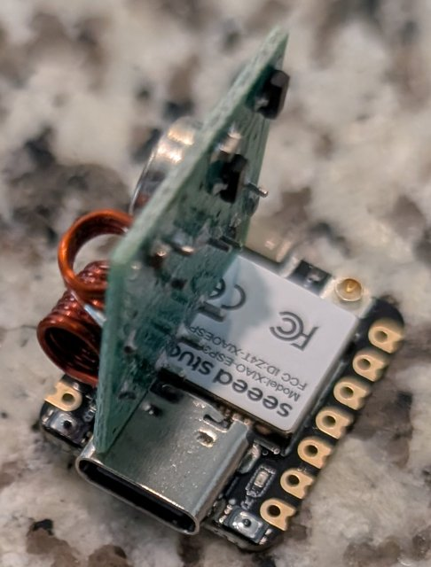
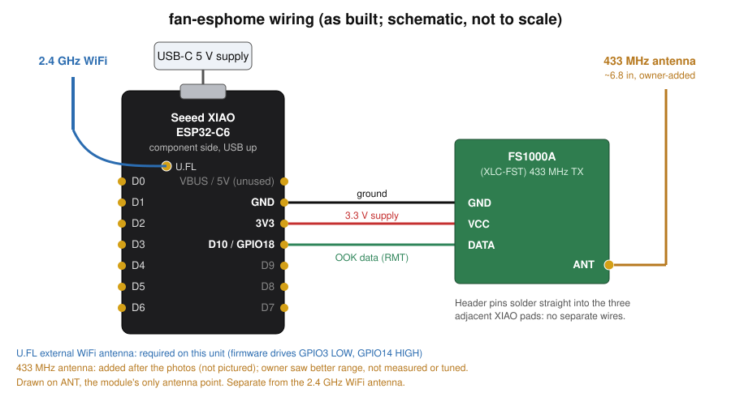
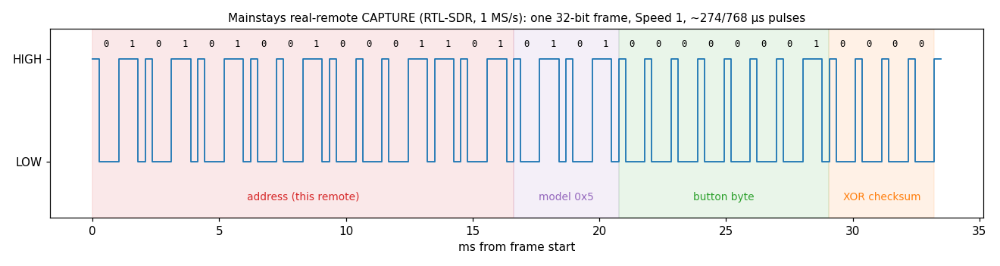
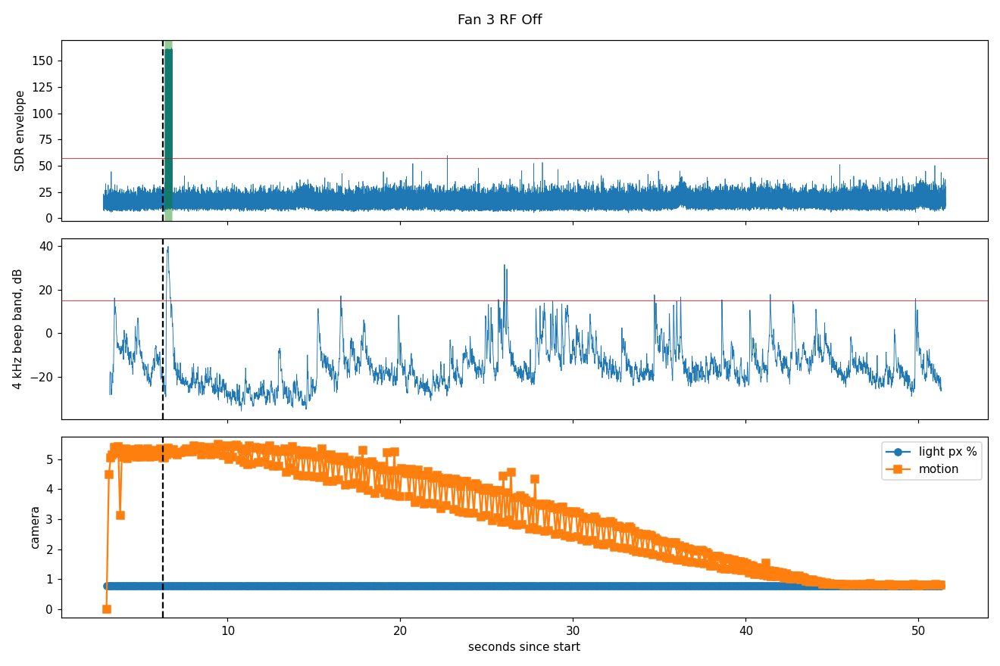
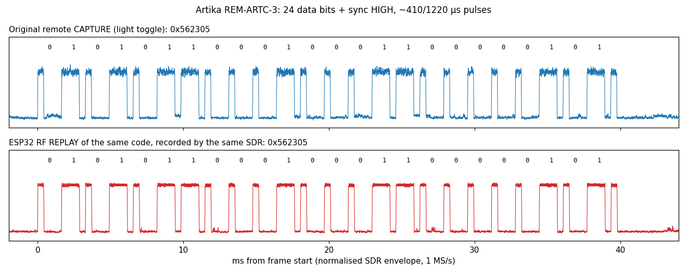

# fan-esphome

ESPHome firmware that turns a Seeed XIAO ESP32-C6 and a cheap 433 MHz transmitter into a WiFi bridge for RF-remote ceiling fans. Home Assistant controls the fans and lights through the ESPHome native API. RF is one-way, so the bridge sends commands but cannot read the fans' state.

## Supported fans

| Fan | Remote | Home Assistant gets | Status |
|---|---|---|---|
| [Mainstays 42 in. Hugger Ceiling Fan with LED Light](https://www.walmart.com/ip/Mainstays-42-in-Hugger-Ceiling-Fan-with-LED-Light-Remote-Control-6-Speeds-Reverse-Airflow-Black-Walnut-Blades/19292811884), model FSI 90-4201H-4B | 433.92 MHz OOK, 32-bit frames, 16-bit address per remote | Fan entity (speeds 1–6, off, direction) plus 13 buttons: Light On/Off, raw speeds, off, reverse, color, brighter, dimmer | Two fans configured. RF replay checked by SDR on one fan. See [verification](#how-these-fans-were-recorded-and-verified). |
| [Artika Sunnyvale 28" Fandelier with Remote](https://www.costco.com/p/-/artika-sunnyvale-28-fandelier-with-remote/4000392789) | REM-ARTC-3, FCC ID 2AUHG-FAN-SUR2, 433.92 MHz, 24-bit fixed codes | 13 buttons: Light On/Off, Fan Power Toggle, Speed 1–3, Reverse, Brightness Up/Down, Cooler, Warmer, Timer 1h/4h | All 13 tested by the owner after the bridge was moved closer to the fan |

Know these limits before you rely on it:

- **Light On and Light Off both send the remote's light toggle.** Neither remote has a separate on or off command. Either button can switch the light either way, and every press is sent, even a repeat.
- **The fan state shown in Home Assistant is assumed.** Pressing the physical remote or a raw button doesn't update it.
- **Your remote has its own address.** The codes in this repo belong to the owner's remotes. Read your remote's address once with an SDR (see [Adding a fan](#adding-a-fan-or-a-new-remote)) before your fan will respond. You don't need an SDR to run a controller that is already configured.
- **Not measured:** the full 1h/4h timer durations, the RF carrier frequency, and the usable range.

## Hardware

### Required to run the controller

| Part | Notes |
|---|---|
| Seeed Studio XIAO ESP32-C6 | Transmit data on **D10 = GPIO18** |
| FS1000A 433 MHz OOK transmitter (board marked XLC-FST) | Wired DATA → D10, VCC → 3V3, GND → GND (see photos). Powered from **3.3 V** in this build; VBUS/5 V is unused. |
| 2.4 GHz U.FL WiFi antenna for the XIAO | **Required as configured.** This unit's built-in ceramic antenna found no networks, so the firmware drives GPIO3 LOW and GPIO14 HIGH to select the U.FL connector. On a board with a working ceramic antenna, set `antenna_select` in `fan-esphome.yaml` to `ALWAYS_OFF`. |
| 433 MHz antenna on the transmitter (recommended) | The owner added a ~6.8 in (17 cm) antenna and saw better signal strength and range. That is an observation, not a measured gain or a tuned length. This antenna is separate from the WiFi antenna. |
| USB-C power supply and data cable | Use the cable for the first flash; later updates go over WiFi |

Placement matters. The first Artika light test failed, and it worked after the bridge was moved closer to the fan. Common FS1000A listings quote 3.5–12 V and longer range at higher voltage. This build has only been tested at 3.3 V; 5 V is untested here.

An optional snap-fit enclosure exists for this board pair, but it is not part of this repo.

### Optional: capture and verification gear

| Item | Needed for |
|---|---|
| RTL-SDR dongle (an RTL2832U + R820T2, such as a Nooelec NESDR Mini 2, was used) and the native `rtl_sdr` program | **Required once** to read a new remote's address or decode a new protocol. Also used to check the bridge's transmissions. |
| PC microphone | `tools/rf_bench.py` only. It hears the fan's confirmation beep (fan commands beep; light commands don't). |
| HTTP JPEG snapshot camera (an ESP32 camera running ESPHome in snapshot mode was used) | `tools/rf_bench.py` only: light on/off and blade motion before and after. Optional. |
| FFmpeg | `rf_bench.py --video` only |

### Build photos and wiring

The transmitter's three header pins solder straight into the XIAO's GND, 3V3 and D10 pads, with no separate wires. These photos were taken before the 433 MHz antenna was added.

| XIAO back: GND, 3V3, D10 soldered; VBUS bare | FS1000A: DATA, VCC, GND header; ANT pad | Assembled, transmitter upright beside the USB-C port |
|---|---|---|
|  |  |  |



## Quick start

Tested on Windows with Python 3.11 and ESPHome 2026.6.5. Run these from PowerShell; ESP-IDF builds fail under Git Bash. On Linux or macOS, use `python3` and `.venv/bin/` in place of `.venv\Scripts\`.

1. Create the environment. This is the only Python dependency needed to build and run the controller.

   ```powershell
   python -m venv .venv
   .venv\Scripts\python -m pip install -r requirements.txt
   ```

2. Create the local config files. Both files are git-ignored, so credentials and room names stay off GitHub.

   ```powershell
   copy secrets.example.yaml secrets.yaml        # WiFi, fallback AP, OTA password, API key
   copy fan-names.example.yaml fan-names.yaml    # display names, e.g. room names
   .venv\Scripts\python -c "import base64,secrets;print(base64.b64encode(secrets.token_bytes(32)).decode())"
   ```

   Paste that output into `secrets.yaml` as `api_encryption_key`. ESPHome rejects the placeholder value.

3. Set your fans. Put your remote's address in the `packages:` list of `fan-esphome.yaml`, and its codes in `artika.yaml` (see [Adding a fan](#adding-a-fan-or-a-new-remote)). Remove the packages for fans you don't have.

4. Validate, build and flash. The first compile downloads the ESP-IDF toolchain and takes several minutes.

   ```powershell
   .venv\Scripts\esphome config fan-esphome.yaml
   .venv\Scripts\esphome run fan-esphome.yaml --device COM5   # first flash over USB; use your port
   .venv\Scripts\esphome run fan-esphome.yaml                 # later updates over WiFi
   .venv\Scripts\esphome logs fan-esphome.yaml                # each press logs "RF TX ..."
   ```

5. Add the device in Home Assistant. Go to Settings → Devices & services. Home Assistant normally discovers `fan-esphome`; enter the API key from `secrets.yaml` when asked. Keep the U.FL WiFi antenna attached and the power stable. The PC and SDR are not needed once the device is in Home Assistant.

### Using it in Home Assistant

- In automations, call `button.press` on the Light On and Light Off buttons. These are not `light.turn_on` entities.
- Mainstays fan entities send only what changed: a speed, an off, or one reverse toggle per direction change. Reverse takes effect only while the fan is stopped.
- Artika speed buttons and Fan Power Toggle are separate buttons. Artika has no fan entity, because the remote only has a power toggle.
- Renaming a fan in `fan-names.yaml` changes its Home Assistant entity identity, then requires a rebuild and flash. For room renames, prefer friendly names set in Home Assistant. See [migration notes](docs/PROTOCOLS.md#home-assistant-migration-notes).

## Adding a fan or a new remote

You only need the SDR here. The microphone and camera add optional evidence.

- **Another fan of a supported family:** follow [`.agents/skills/adding-fans`](.agents/skills/adding-fans/SKILL.md). Capture any button with `tools/rf_capture.py`, then add one package line and a local name.
- **A remote of a different brand:** follow [`.agents/skills/investigating-fan-remotes`](.agents/skills/investigating-fan-remotes/SKILL.md). It covers the FCC ID lookup, capturing every button, decoding, and a supervised replay.

Both are agent skills, but people can follow them too. They depend only on files in this repo plus the SDR setup below.

### Optional tool setup

```powershell
.venv\Scripts\python -m pip install -r tools\requirements.txt
.venv\Scripts\python tools\rf_capture.py record my_remote --seconds 6   # SDR only
.venv\Scripts\python tools\rf_bench.py --button "Fan 3 RF Speed 1" --expect <32 bits> --mic "PART_OF_MIC_NAME"
```

| Tool | Needs |
|---|---|
| `tools/rf_capture.py`: record and decode any PWM OOK remote to raw `.cu8` | RTL-SDR, `rtl_sdr`, numpy (matplotlib for `--plot`) |
| `tools/rf_bench.py`: press through the API, record SDR + mic + camera on one clock, decode the Mainstays 32-bit frames | All of `tools/requirements.txt`, `rtl_sdr`, a microphone, and the camera optionally |
| `tools/make_readme_figures.py`: regenerate the evidence figures below | Local recordings (not in the repo) |

`rtl_sdr` setup, by OS. Put it on `PATH`, or set the `RTL_SDR_EXE` environment variable to its full path.

- **Windows:** download the osmocom rtl-sdr Windows release, and install the WinUSB driver for the dongle with Zadig. This build used a local `rtl_sdr.exe` selected through `RTL_SDR_EXE`.
- **Debian/Ubuntu:** `sudo apt install rtl-sdr libportaudio2`. If the kernel DVB driver claims the dongle, blacklist `dvb_usb_rtl28xxu`.
- **macOS:** `brew install librtlsdr portaudio`.

Only the Windows path was used for this project. `sounddevice` needs PortAudio on Linux and macOS. Close SDR# or any other program using the dongle first; `rtl_sdr` takes about 2 s before samples flow.

## Repository layout

| File | Contents |
|---|---|
| `fan-esphome.yaml` | Device, WiFi, antenna switch, transmitter, Mainstays timing and button bytes, list of fans |
| `fan.yaml` | One Mainstays fan, included once per fan with its address |
| `artika.yaml` | Artika 24-bit codes and waveform |
| `secrets.example.yaml`, `fan-names.example.yaml` | Neutral templates for the ignored local files |
| `requirements.txt` / `tools/requirements.txt` | Minimum build dependency / optional bench dependencies |
| `docs/PROTOCOLS.md` | Protocol detail, test history, verification limits, migration notes |
| `.agents/skills/` | Step-by-step guides for adding fans and investigating remotes |

Keep this repo private. `secrets.yaml`, `fan-names.yaml`, `.esphome/`, `.venv/` and `runs/` (raw recordings, audio, room camera frames) are git-ignored. Committed images are cropped to the boards or to the fan. The configured RF addresses are committed on purpose; review them before any public release.

## How these fans were recorded and verified

Each claim in this project is backed by one of four kinds of evidence. They are kept apart because each proves something different:

- **Capture:** the original remote, recorded with the RTL-SDR at 433.92 MHz and 1 MS/s.
- **Prediction:** a code computed from the protocol model. It was not captured.
- **RF replay:** the bridge's own transmission, recorded by the same SDR. It proves what was sent, not that the fan accepted it.
- **Human confirmation:** the owner watched the fan respond.

The microphone and camera were indirect evidence. A beep shows a fan command was accepted, not which speed was set.

**1. Capture: Mainstays remote, Speed 1.** One of ten repeated frames, 274/768 µs pulse-width coding. The 16-bit address identifies the remote. The final nibble makes all eight nibbles XOR to zero, so the firmware computes it for any button: that makes untested buttons predictions.



**2. RF replay plus mic and camera: Mainstays Fan Off sent by the bridge.** This is a `rf_bench.py` timeline with SDR, mic and camera on one clock, recorded 2026-11-20:

- **Top:** all 10 frames match the predicted code. Pulses are 281/761 µs, with an 8438 µs sync gap.
- **Middle:** a 4 kHz beep 0.2 s after the press.
- **Bottom:** camera blade motion falls to zero over about 40 s.

These are recordings only. The audio itself is not published.



**3. RF replay plus camera: stateless light buttons.** The camera image was taken after each of four presses in a row: On, On, Off, Off. Each press sent nine SDR frames matching the toggle code. The light alternated, which shows both buttons are toggles. Images are cropped to the fan.


**4. Capture vs RF replay: Artika light toggle.** The top trace is the original remote; the bottom is the bridge's replay on the same SDR. Both decode to `0x562305`, and their timing is within about 15 µs. The first replay did not switch the light. After the owner moved the bridge closer, the owner confirmed every Artika control in Home Assistant. That is human confirmation; detailed observations were not recorded for each button.



Figures 1–4 were generated by `tools/make_readme_figures.py` from git-ignored recordings. The build photos are crops of the owner's photos with location metadata removed. The full protocol tables, the discrete-light-command search, the Artika carrier analysis and the limits are in [docs/PROTOCOLS.md](docs/PROTOCOLS.md).
